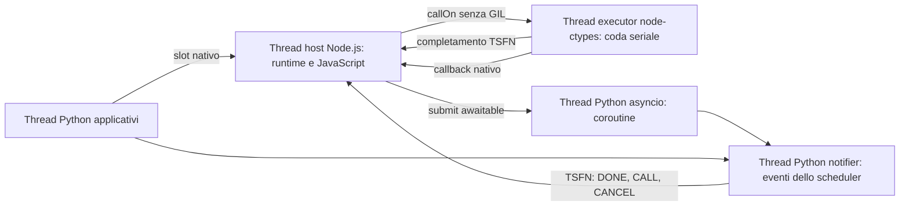
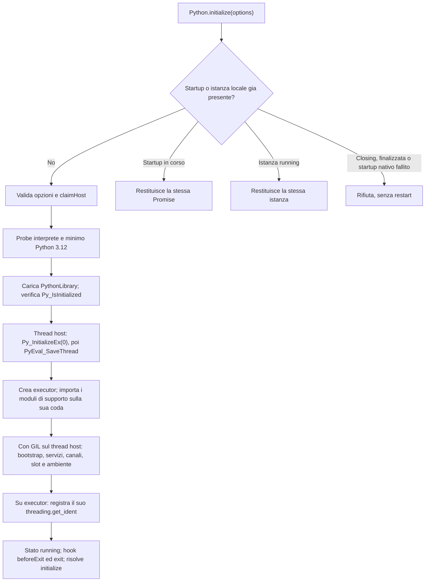
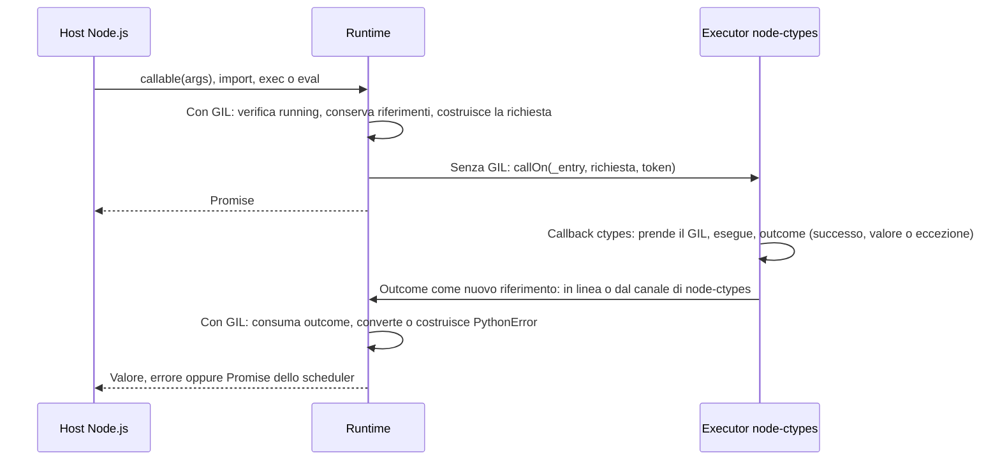
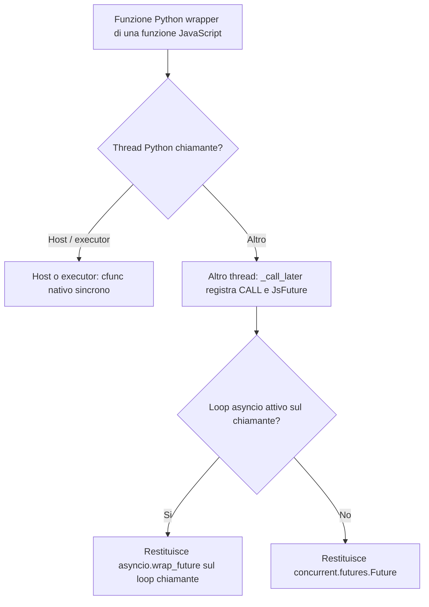
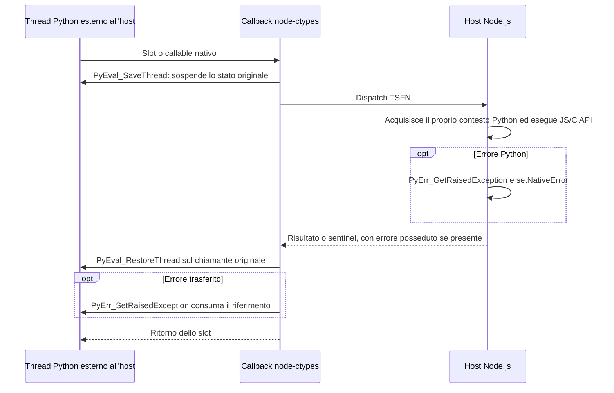
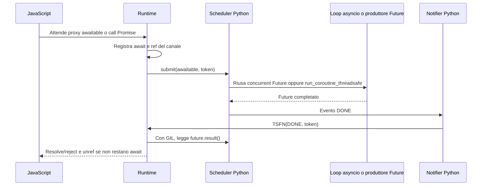
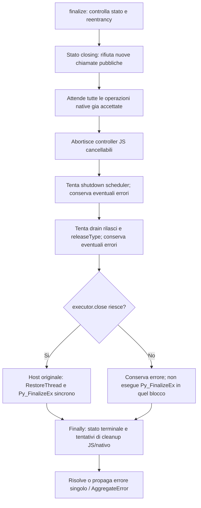

# Flussi di node-python

Questo documento descrive l'implementazione attuale, inclusi ownership,
concorrenza, percorsi di errore e limiti. I riferimenti indicano i moduli e i
metodi da confrontare quando il codice cambia. Uso dell'API e comandi di sviluppo
sono nel [README](./README.md); gli [esempi](./examples) illustrano le funzionalita.

CPython viene caricato **nello stesso processo di Node.js**. Il subprocess della
discovery legge la configurazione dell'interprete, non esegue le successive
chiamate applicative. Non sono implementati isolamento del codice Python,
subinterpreti o un servizio Python remoto.

## Indice

1. [Moduli e thread](#1-moduli-e-thread)
2. [Avvio, discovery e stati](#2-avvio-discovery-e-stati)
3. [Esecuzione delle chiamate pubbliche](#3-esecuzione-delle-chiamate-pubbliche)
4. [Oggetti e callable JavaScript in Python](#4-oggetti-e-callable-javascript-in-python)
5. [Scheduler, await e cancellazione](#5-scheduler-await-e-cancellazione)
6. [Proxy Python in JavaScript](#6-proxy-python-in-javascript)
7. [Conversioni per valore](#7-conversioni-per-valore)
8. [Buffer, date e stream](#8-buffer-date-e-stream)
9. [Iterazione, context manager e abort](#9-iterazione-context-manager-e-abort)
10. [Errori, ownership e diagnostica](#10-errori-ownership-e-diagnostica)
11. [Finalizzazione e uscita del processo](#11-finalizzazione-e-uscita-del-processo)
12. [Test e isolamento delle fixture](#12-test-e-isolamento-delle-fixture)

## 1. Moduli e thread

| Componente                                                                           | Responsabilita                                              |
| ------------------------------------------------------------------------------------ | ----------------------------------------------------------- |
| [index.ts](./src/index.ts), [types.ts](./src/types.ts), [values.ts](./src/values.ts) | Export, contratti, errori, tuple e marcatori                |
| [runtime.ts](./src/runtime.ts)                                                       | Lifecycle, proxy, conversioni e coordinamento               |
| [host.ts](./src/host.ts)                                                             | Prenotazione esclusiva del thread host nel processo         |
| [interpreter.ts](./src/interpreter.ts)                                               | Probe, percorsi, ricerca e caricamento della libreria       |
| [native.ts](./src/native.ts)                                                         | Firme ctypes e strutture della C API                        |
| [executor.ts](./src/executor.ts)                                                     | Executor node-ctypes delle operazioni native                |
| [bootstrap.ts](./src/bootstrap.ts)                                                   | Namespace privato, wrapper canonico e layout base           |
| [objects.ts](./src/objects.ts)                                                       | Slot nativi, callable factory e code degli ID rilasciati    |
| [scheduler.ts](./src/scheduler.ts)                                                   | Await, callback differiti, cancellazione e wakeup           |
| [conversions.ts](./src/conversions.ts), [temporal.ts](./src/temporal.ts)             | Mapping, coercizioni, date, Temporal e formattazione errori |
| [buffers.ts](./src/buffers.ts)                                                       | Memoryview, formati ed esportazione dei buffer              |
| [platform.ts](./src/platform.ts)                                                     | Stream Python collegati a Node.js                           |

L'**host** e il thread JavaScript che inizializza CPython: puo essere il main
thread Node.js oppure un `worker_threads.Worker`, ma e unico nel processo.
I proxy non sono trasferibili tra isolate.

L'**executor** e un `Executor` di node-ctypes (thread nativo con coda FIFO), non
un worker JavaScript o libuv. Esegue in sequenza le operazioni native pubbliche:
ogni richiesta e la chiamata, su quel thread, di una callback ctypes Python che
prende il GIL. Il thread tiene un thread state Python dall'avvio alla chiusura. Il **loop asyncio**,
avviato pigramente in un altro thread daemon, esegue le coroutine.
Il **notifier** dello scheduler e ancora un thread distinto: consegna eventi
senza bloccare il loop asyncio nella callback verso Node.
I completamenti dell'executor arrivano dal canale di node-ctypes, non da questo notifier.

Il package usa il node-ctypes pubblicato, senza shim compilati propri.
I servizi TypeScript invocano C API e libreria standard; restano adattatori
Python per code, frame di generatori/coroutine, stream e operazioni che devono
avvenire sul thread chiamante. Il namespace privato `_node_ctypes` conserva
il loro stato e non e un'API pubblica.

## 2. Avvio, discovery e stati

Fonti: `Python.initialize`, `#start`, `#startInterpreter`, `#setup` in
[runtime.ts](./src/runtime.ts), [host.ts](./src/host.ts),
[interpreter.ts](./src/interpreter.ts) e `PythonLibrary` in
[native.ts](./src/native.ts).

### Singleton e host di processo

Le variabili `instance`, `initialization` e `initializationFailure` sono locali
al modulo JavaScript. Chiamate concorrenti nello stesso modulo condividono la
Promise di startup; le opzioni sono scelte al primo avvio. Il costruttore
diretto viene rifiutato.

La prenotazione **di processo** e separata dal singleton:

- Windows: `CreateMutexW` con nome contenente il PID; se il nome esiste gia,
  il nuovo handle viene chiuso e la richiesta rifiutata, senza attendere.
- Linux/macOS: `sem_open` con `O_CREAT | O_EXCL` e nome derivato da UID/PID.
  La prenotazione e la creazione esclusiva, non un'attesa sul semaforo.
- `releaseHost` agisce solo sulla prenotazione posseduta da quel modulo.
  Il rilascio ripetuto e innocuo; gli errori nativi non sono nascosti.

Questo coordina anche worker e copie distinte del package. Non si tenta di
recuperare automaticamente un host abbandonato: terminare il worker non rende
CPython riavviabile in sicurezza. Un nome POSIX puo sopravvivere al processo e
bloccare un successivo riuso del PID; l'eventuale `sem_unlink` manuale richiede
prima la certezza che il proprietario sia terminato.

### Discovery e binding

1. `executable`, oppure `PYTHON`, seleziona un solo candidato. Senza override
   si provano `py -3`, `python`, `python3` su Windows; `python3`, `python` altrove.
2. Il probe usa `execFile`, timeout di 10 secondi e output JSON validato:
   versione, executable/base prefix assoluti, percorsi e metadata della libreria.
   Gli errori distinguono comando mancante, exit nonzero, timeout, JSON e metadata
   invalidi. Se nessuno riesce, un `AggregateError` conserva le singole cause.
3. `library`/`PYTHON_LIBRARY` prevalgono sulla ricerca. Altrimenti si usano nomi
   e directory riportati dall'interprete, ABI flags, framework macOS e, come
   fallback disponibile, `INSTSONAME` tramite dynamic linker.
4. Su Windows `AddDllDirectory(base_prefix)` precede anche il caricamento di
   una libreria esplicita. Il runtime possiede il cookie e ne controlla il rilascio.
5. `PythonLibrary` apre con `RTLD_GLOBAL`, configura prima `Py_GetVersion` e
   confronta **major/minor**, non patch, build o tutti gli ABI flags.
   Poi assegna `.argtypes` e `.restype` alle funzioni. Versione/architettura/ABI
   compatibili restano un requisito: non esiste una certificazione autonoma del
   binario. Una DLL ABI3t di compatibilita non trasforma una build GIL in free-threaded.

Gli oggetti CPython sono opachi: i relativi indirizzi vengono risolti con
`in_dll`/`addressof`, senza assumere offset dell'header. Il caricamento e lo
startup nativo sono lavoro sincrono sul thread host.

### Setup e fallimenti

`Py_IsInitialized` rifiuta un CPython gia avviato da altro codice nel processo.
Fuori da Windows, `PYTHONHOME` viene impostato temporaneamente al `base_prefix`
solo se assente, e ripristinato nel `finally`.
`Py_InitializeEx(0)` avviene sull'host; subito dopo `PyEval_SaveThread` conserva
lo stato originario e rilascia il contesto, **prima** di creare l'executor.

Il setup crea `FinalizationRegistry`, trampoline e servizi, apre il canale dello
scheduler, pubblica il namespace privato e installa gli oggetti nativi.
Assegna `sys.path = ["", ...info.path]`, `sys.executable` e
`sys.argv = [process.argv[1] ?? ""]`: non copia tutti gli argomenti Node e non
esegue uno script di attivazione della virtualenv. Imposta infine
`sys.setswitchinterval(switchInterval / 1000)`, con default 5 ms come CPython
(vedi sezione 3).

| Stato                  | Significato                                                              |
| ---------------------- | ------------------------------------------------------------------------ |
| `initializing`         | Setup interno consentito, API pubbliche non ancora disponibili           |
| `running`              | Accetta chiamate pubbliche                                               |
| `closing`              | Rifiuta nuovo lavoro pubblico; proseguono drain e cleanup                |
| `finalized` / `failed` | Terminale per il runtime; nessuna reinizializzazione tramite quel modulo |

Un fallimento **prima** dell'avvio di CPython chiude la libreria inutilizzata,
rilascia registrazione DLL e host e permette un altro tentativo.
Se CPython e gia stato avviato, `#start` memorizza il fallimento e tenta
`#finish("failed")`: non offre restart. Un errore del cleanup viene riportato
insieme a quello originale. Uno stato terminale non implica che ogni operazione
di cleanup abbia avuto successo.

## 3. Esecuzione delle chiamate pubbliche

Fonti: `#track`, `#nativeCall`, `#consumeOutcome`, `#callAsync`, `#executeSource`
in [runtime.ts](./src/runtime.ts); `PythonExecutor` in
[executor.ts](./src/executor.ts).

La coda e quella dell'`Executor` di node-ctypes (FIFO). La richiesta contiene
operazione e argomenti; le operazioni sono import, esecuzione sorgente e chiamata
Python. Le tuple mantengono vivi callable e argomenti durante l'attesa.
`_entry` e una callback `ctypes.CFUNCTYPE`: ctypes prende il GIL intorno alla
chiamata e la callback restituisce l'outcome come nuovo riferimento, posseduto
dall'host (nessun registro Python intermedio). La richiesta viene accodata dopo
aver rilasciato il GIL: una richiesta breve completa mentre l'host la attende in
linea (budget per funzione di node-ctypes), le altre tramite il canale di
completamento di node-ctypes.

Il primo job dell'executor e `PyGILState_Ensure` seguito da `PyEval_SaveThread`:
il thread state resta associato al thread executor fino alla chiusura, quindi lo
stato thread-local Python (`threading.local`, contesto `decimal`, ...) sopravvive
tra le richieste. L'executor usa binding propri di queste funzioni, distinti da
quelli dell'host.

Gli identificatori sono positivi nel range signed 32 bit. `nextCompletionToken`
riparte da 1 e salta quelli pendenti; esaurire tutti gli identificatori liberi
produce un errore, non un riuso ambiguo. Non e un limite al numero cumulativo di
richieste completate. Helper e indirizzo di `_entry` vengono risolti prima di
avviare l'executor: un setup fallito non lascia un thread con un thread state.

L'executor tiene vivo il processo solo con richieste pendenti. Nessun worker
libuv resta in attesa di Python. Non esiste backpressure applicativa automatica.

### Risultati, namespace e richieste pendenti

- `exec`/`eval` compilano ed eseguono nella **stessa richiesta**, con globals e
  locals di `__main__`. Un altro elemento della coda non si inserisce tra le due
  fasi; callback e coroutine non diventano transazioni.
- `exec` scarta il valore; `eval` applica deep conversion. `import("a.b")`
  restituisce il modulo richiesto, come proxy pubblico.
- Tutti i callable pubblici, inclusi metodi, builtin e classi, restituiscono
  Promise. `await new cls(...)` conserva esplicitamente il risultato come proxy.
  `kwargs` e riconosciuto solo nell'ultima posizione; senza keyword non viene
  costruito un dizionario vuoto.
- Se il risultato e awaitable, `#callAsync` lo registra nello scheduler e
  appiattisce la Promise pubblica. L'executor puo gia eseguire altre richieste.

`#pending` traccia l'operazione nativa interna, che restituisce `{ value }`.
La Promise pubblica estrae `value` e ne assimila l'eventuale Promise.
Quindi **drain nativo e attesa di tutte le coroutine non sono equivalenti**.
Anche gli handler pubblici di un risultato possono eseguire dopo la rimozione
dell'ultimo elemento da `#pending`: e importante per il dispose in chiusura.

Le viste `InternalPythonObject` usate dai servizi sono invece sincrone.
Non sono un'opzione pubblica per eseguire arbitrariamente lavoro bloccante.
`#withGIL` usa `PyGILState_Ensure/Release` solo ai bordi esterni e bilancia
`#depth` in `finally`; `#busy` segnala agli adattatori l'occupazione dell'host.
Sono meccanismi di contesto Python, non una garanzia di non bloccare Node,
anche su build free-threaded.

Su build con GIL, `PyGILState_Ensure` blocca il thread Node finche un thread
Python non cede il GIL. Ogni chiamata pubblica lo acquisisce piu volte: invio,
completamento e conversione. Con thread Python CPU-bound e lo switch interval
di default (5 ms), su Windows le attese misurate arrivavano a 100-200 ms per
chiamata e a 150-400 ms di event loop fermo. Con `switchInterval: 0.5` scendono
sotto i 50 ms, ma due thread Python CPU-bound in competizione rallentano del
40-150%. Tra 0,5 e 1 ms c'e un salto netto: da 1 ms in su l'attesa torna simile a
quella con 5 ms, probabilmente per la granularita dei timer di Windows. Il
default resta quindi quello di CPython. Chi non deve bloccare mai l'event loop
principale puo ospitare Python in un worker.

## 4. Oggetti e callable JavaScript in Python

Fonti: `#jsProxy`, `#jsOp`, `#function`, `#callJS` in
[runtime.ts](./src/runtime.ts); `PythonBootstrap` in
[bootstrap.ts](./src/bootstrap.ts); `NativeObjects` e `nativeSlot` in
[objects.ts](./src/objects.ts).

### Identita e protocolli degli oggetti condivisi

`#objectIds` assegna un ID all'oggetto JavaScript; `#objects` lo trattiene e conta
le istanze Python che lo condividono. Una nuova istanza Python dello stesso
oggetto incrementa il contatore, non crea una nuova identita JavaScript.
Gli oggetti raggiunti attraverso una proprieta condivisa restano per riferimento,
salvo i percorsi speciali di conversione.

Il bootstrap crea con `type` il layout base con `_id` e weakref.
`NativeObjects` ne deriva un heap type con `PyType_FromSpecWithBases`, ereditando
layout e lifecycle senza offset hardcoded. Questo percorso e obbligatorio:
supporto nativo mancante e errore di inizializzazione, non fallback.

| Protocollo Python                                    | Implementazione                                                                 |
| ---------------------------------------------------- | ------------------------------------------------------------------------------- |
| Attributi e item, inclusi assegnamento/cancellazione | Slot C API che invocano `#jsOp`; gli attributi Python del tipo hanno precedenza |
| `len`, truth, membership                             | Slot nativi; lunghezza controllata come `Py_ssize_t`, senza wrapping silenzioso |
| `repr`, `str`, `dir`                                 | Slot/metodo nativo; `dir` raccoglie nomi senza leggere i getter JS              |
| Hash ed equality                                     | Identita tramite `_id`, non uguaglianza strutturale JavaScript                  |
| Iterazione                                           | Factory nativa che restituisce un vero generatore Python lazy                   |
| Async iteration                                      | Secondo heap type e coroutine Python `__anext__`                                |
| Await di un oggetto condiviso                        | Adattatore Python `__await__` collegato al future dello scheduler               |

Per equality viene conservato l'ordine `other._id == self._id`; inequality
nega il risultato di equality. Gli ordinamenti restituiscono `NotImplemented`
per permettere il dispatch riflesso Python.
I metodi JavaScript letti da Python sono legati al loro receiver; viene mantenuto
anche il marcatore `cancellable`.

### Callable e scelta del percorso

`#function` conserva funzione JS e `PyMethodDef` fino al rilascio del wrapper.
Durante il bootstrap usa la factory canonica; a regime la factory nativa
ricrea la funzione con lo **stesso code object** in un namespace privato.
Il round-trip riconosce quel code object, non solo `_node_ctypes_id` o metadati
copiabili con un decorator. Nome, doc e normale identita della funzione
restano disponibili.

Le classi JavaScript riconosciute sintatticamente usano `Reflect.construct`.
Il wrapper espone anche `.new(...)`, il cui dispatcher nativo supporta keyword
e chiamate da worker Python. Non richiede una classe sintattica.

Nel percorso diretto, restituire una Promise JavaScript genera `TypeError`;
la sua eventuale rejection viene consumata, ma il risultato non viene recuperato.
Un callback `cancellable` diretto riceve un nuovo segnale non collegato alla
cancellazione remota. Per attendere JavaScript asincrono si usa il percorso
future/coroutine, non una Promise dentro uno stack sincrono bloccante.

Questo vale anche per API JavaScript che richiamano immediatamente funzioni Python,
come `EventEmitter.emit`: se invocate nello stack sincrono executor, il listener
Python tenterebbe un rientro asincrono vietato. L'esempio
[callbacks.ts](./examples/callbacks.ts) esegue e attende `emit` da una coroutine,
passando dal gestore differito dello scheduler. `emit` non attende le Promise
dei listener: il suo completamento non garantisce quello di listener asincroni.

### Contesto nativo ed errori del thread chiamante

`nativeSlot` passa al core `suspend`, `resume`, `onError`, rispettivamente
`PyEval_SaveThread`, `PyEval_RestoreThread`, `PyErr_SetRaisedException`.
Sul thread host il callback e diretto, senza sospendere un chiamante esterno.
Non viene trasferito il thread state Python sul thread Node: impostare soltanto
l'errore del thread Node non propagherebbe l'eccezione al chiamante corretto.

Lo stato di errore appartiene alla singola invocazione, anche con concorrenza
e rientri. Lo slot restituisce il proprio sentinel (`NULL`, `-1`, ecc.) e il
core ripristina il chiamante prima di applicare l'errore.
Il wrapper core mantiene vivi gli owner degli hook; cio non autorizza a
scaricare la libreria o rilasciare callback mentre i chiamanti sono attivi.
Il supporto rimane limitato al main interpreter.

## 5. Scheduler, await e cancellazione

Fonti: `#promise`, `#onEvent`, `#serve`, `run` in
[runtime.ts](./src/runtime.ts); `submit`, `takeRequest`, `settle`, `JsFuture`
e adattatori in [scheduler.ts](./src/scheduler.ts).

### Python awaitable verso JavaScript

Solo `inspect.isawaitable` e `concurrent.futures.Future` rendono un proxy
thenable. `#promise` conserva una Promise per stato del proxy, non una cache
globale di tutti i wrapper dello stesso oggetto.
Un concurrent future viene riusato; per gli altri awaitable lo scheduler avvia
un loop daemon e usa `run_coroutine_threadsafe`. Le coroutine vengono inviate
direttamente, mentre gli altri awaitable sono adattati con una coroutine che
li attende. In questo modo una Task cancellata prima del primo passo chiude
la coroutine originale, senza lasciarla mai attesa dentro un wrapper cancellato.
Un errore nell'avvio del loop viene comunicato al chiamante, senza lasciare
la Promise registrata per sempre.

La lettura del risultato e shallow: `await` non equivale a `toJS`.
Il canale scheduler e normalmente `unref`; solo gli await pendenti lo
referenziano. La semplice presenza di thread Python o richieste di callback
non e una garanzia di liveness del processo Node.

### JavaScript richiamato da altri thread Python

`_call_later` crea `JsFuture`, registra `_requests[token]` e invia `CALL`.
Il notifier consegna il token all'host, dove `takeRequest` rimuove la richiesta
e ne sposta gli owner in `_calls`. Una richiesta cancellata o gia prelevata
non viene invocata una seconda volta.

`#serve` converte gli argomenti, aggiunge l'eventuale oggetto keyword e il segnale
di `cancellable`, poi invoca JavaScript. Un risultato sincrono viene risolto
subito: potrebbe essere servito dentro Python, dove non possono proseguire le
microtask Node. Una Promise completa invece il future quando si risolve.
Un valore non convertibile viene restituito come errore del future.

Gli adattatori eseguono `asyncio.wrap_future` **sul thread Python chiamante**,
dove e noto il loop attivo. I callback nativi di enqueue restituiscono prima un
concurrent future: non scelgono il loop dal thread Node.
Senza loop attivo resta disponibile `JsFuture.result()`.
Un'attesa senza timeout emette un warning dopo cinque secondi solo se l'host
risulta occupato, poi continua: non e un timeout o una soluzione al deadlock.

Il runtime permette il rientro asincrono dal gestore differito `#serve`;
una nuova operazione Python asincrona da callback sincrono diretto viene invece
rifiutata. Leggere una proprieta live resta un'operazione sincrona.

### Wakeup opt-in durante operazioni live

Le invocazioni pubbliche ordinarie lasciano libero Node grazie all'executor.
L'opt-in `synchronousCallbacks` serve invece alcune attese sincrone
interrompibili sull'host:

1. Su POSIX installa un handler SIGURG solo con primitive disponibili e senza
   sostituire un handler applicativo gia attivo; il wakeup usa `pthread_kill`.
2. Su Windows Python 3.14+ prova l'export privato `_PyOS_SigintEvent` e usa
   pending-call piu `SetEvent`/`ResetEvent`. L'assenza del meccanismo necessario
   fa rifiutare la registrazione del dispatcher, non abilita un falso supporto.
3. Un notifier nativo sveglia l'host; il signal/pending-call handler esegue i
   dispatcher registrati e `drain()` degli slot. Il core rivendica ogni richiesta
   una sola volta tra drain e consegna TSFN.

Non e un event-loop pump. Una Promise non puo proseguire su uno stack Node
bloccato; attese arbitrarie in un'estensione C possono ancora causare deadlock.

### Cancellazione nelle due direzioni

- `run(..., { signal })` rifiuta subito con `signal.reason`. Per una chiamata,
  `exec`, `eval` o `import` interrompe la richiesta executor (vedi §9); se il
  callable produce un awaitable, richiede `future.cancel`, anche quando l'abort
  e arrivato prima che il future fosse disponibile.
- Python che cancella un future di chiamata JS rimuove l'evento ancora accodato,
  oppure invia `CANCEL`. Il runtime abortisce il controller di `cancellable`.
  JavaScript deve cooperare; non viene terminata forzatamente la funzione.
- `settle` ignora future cancellati/non piu presenti. Dopo la chiusura i
  completamenti tardivi non rientrano in Python.

## 6. Proxy Python in JavaScript

Fonti: `#wrap`, `#proxyHandler`, `#expose` in
[runtime.ts](./src/runtime.ts); fallback in
[conversions.ts](./src/conversions.ts).

Il proxy possiede un riferimento Python. Target e proxy condividono un
`ProxyState` con puntatore, flag pubblico ed eventuale future/Promise.
I proxy pubblici usano chiamate asincrone; quelli dei servizi interni consentono
housekeeping sincrono. `#expose` crea la vista pubblica con un riferimento proprio.

| Operazione JS                                           | Percorso                                                                  |
| ------------------------------------------------------- | ------------------------------------------------------------------------- |
| `obj[index]` con indice intero canonico, anche negativo | C API item, non attributo numerico                                        |
| `obj.name`                                              | Prima attributo Python; su `AttributeError`, fallback mapping/`length`    |
| Assegnamento/cancellazione                              | Attributo prima, poi chiave di MutableMapping quando applicabile          |
| `name in obj`                                           | Attributo o chiave riconosciuta dal servizio                              |
| `Object.keys` / enumerazione                            | Chiavi stringa del mapping o di `__dict__`, non tutte le entry di `dir()` |
| Coercizione / stringa                                   | Protocollo Python; numeri e datetime hanno percorsi specializzati         |
| `toJS` / `toJSON`                                       | Deep conversion sincrona; `JSON.stringify` usa lo stesso percorso         |
| `then`                                                  | Esposto solo per awaitable utilizzabili, non per ogni oggetto Python      |
| Apply / construct                                       | `#callAsync` pubblico oppure chiamata interna sincrona                    |

I nomi degli helper JS e i simboli del proxy hanno precedenza sull'attributo
Python omonimo. Per i callable esiste anche il fallback a membri di
`Function.prototype`, come `bind` e `apply`.
Altri errori Python non vengono reinterpretati come attributi mancanti.

Ogni operazione live entra in `#withGIL` e puo eseguire codice Python.
Una Promise per la chiamata non rende quindi non bloccanti getter, conversioni,
enumerazione, iterazione o dispose. Dopo il rilascio del puntatore o la
finalizzazione, gli accessi non possono riutilizzare l'oggetto.

`module(name, members)` resta sincrono: crea un nuovo `ModuleType`, converte i
membri e lo registra in `sys.modules`. Per nomi puntati collega i parent package,
importandoli o creandoli se davvero mancanti. Non nasconde altri errori di import
e non aggiorna retroattivamente vecchi riferimenti a un modulo sostituito.

## 7. Conversioni per valore

Fonti: `#toPy`, `#fromPy`, `#reference`, `#take`, `#takeDeep` in
[runtime.ts](./src/runtime.ts).

### JavaScript verso Python

| Ingresso                                    | Risultato                                                                  |
| ------------------------------------------- | -------------------------------------------------------------------------- |
| `null`, `undefined`                         | `None`                                                                     |
| Proxy Python gia noto                       | Riusa il puntatore con un nuovo riferimento                                |
| Boolean                                     | `bool`                                                                     |
| Number intero                               | `int`, da long long se safe, altrimenti dal double gia rappresentato da JS |
| Number non intero, NaN, infinita            | `float`                                                                    |
| BigInt                                      | `int` tramite rappresentazione decimale                                    |
| String                                      | Unicode UTF-8 con lunghezza esplicita                                      |
| Array / `Tuple`                             | Copia in list / tuple                                                      |
| Plain object, anche a prototipo nullo / Map | Copia in dict                                                              |
| Set                                         | Copia in set                                                               |
| Funzione                                    | Wrapper callable JavaScript                                                |
| Istanza JS non ordinaria                    | Oggetto condiviso tramite ID                                               |
| Date, Temporal e memoria binaria            | Percorsi della sezione successiva                                          |

Un number gia fuori dalla precisione JS non recupera cifre perdute; usare BigInt
per interi esatti. Il ramo intero include `-0`, che diventa int zero.
Symbol e valori non convertibili producono `TypeError`.

`byReference` condivide i contenitori invece di copiarli e usa memoryview per
memoria binaria, inclusi Buffer/Uint8Array. Per scalari, funzioni e proxy Python
torna ai rispettivi percorsi ordinari.

### Python verso JavaScript

| Tipo Python                                 | Conversione ordinaria                     | Deep conversion                                         |
| ------------------------------------------- | ----------------------------------------- | ------------------------------------------------------- |
| None, bool, int, float, str                 | Scalare JS; int come number safe o BigInt | Uguale                                                  |
| bytes                                       | Buffer copiato                            | Uguale                                                  |
| Wrapper di oggetto/funzione JS riconosciuto | Recupera l'identita JS                    | Uguale                                                  |
| list / tuple built-in                       | Proxy                                     | Array / `Tuple`                                         |
| dict built-in                               | Proxy                                     | Object se tutte le chiavi sono stringhe, altrimenti Map |
| set / frozenset built-in                    | Proxy                                     | Set                                                     |
| Date/time riconosciuti                      | Proxy                                     | Conversioni specializzate disponibili                   |
| Altro oggetto                               | Proxy                                     | Proxy se nessun percorso specializzato si applica       |

I percorsi veloci confrontano il **tipo esatto** dei built-in; non e una promessa
di copia automatica di ogni sottoclasse o iterable.
Gli interi oltre signed 64 bit passano dalla stringa decimale senza troncarli.
Unicode e bytes copiano i dati e conservano lunghezze e NUL incorporati.

La rilevazione dei cicli segue gli antenati della conversione corrente:
un ciclo genera `TypeError`; un riferimento ripetuto ma non ciclico e valido.
Le copie ripetute non preservano identita o alias. Usare proxy live o condivisione
per grafi ciclici. `toPython` forza un proxy anche dove la conversione ordinaria
avrebbe restituito uno scalare.

## 8. Buffer, date e stream

Fonti: `#memoryview`, `#typedArray`, `#keep` in
[runtime.ts](./src/runtime.ts), [buffers.ts](./src/buffers.ts),
[conversions.ts](./src/conversions.ts), [temporal.ts](./src/temporal.ts),
[platform.ts](./src/platform.ts).

### Memoria JavaScript verso Python

Buffer/Uint8Array ordinari fanno eccezione: vengono copiati in `bytes`;
`byReference` richiede invece memoria condivisa. Uint8ClampedArray e le altre
viste seguono il percorso memoryview.
L'owner Python trattiene il backing buffer JavaScript, non solo il suo indirizzo.
Per memoria vuota si usa un owner senza puntatore esterno.
Il formato dipende dalla vista; DataView usa byte.
Non sono introdotti protocolli di sincronizzazione tra thread: non staccare,
trasferire o ridimensionare backing memory ancora usata da Python.

### Memoria Python verso JavaScript

`toTypedArray` crea una memoryview e richiede contiguita C, altrimenti segnala
`BufferError`. Normalizza formati e larghezze native quando riconosciuti;
per formati non riconosciuti ricade sulla vista di byte.

- Buffer read-only: `tobytes()` e copia in memoria JavaScript.
- Buffer writable e external buffer disponibili: un holder Python ottenuto
  con `ctypes.from_buffer` mantiene vivo l'export; `#keep` lo associa al backing
  ArrayBuffer della vista JavaScript.
- External buffer non disponibili, come nelle configurazioni Electron che li
  vietano: copia anche se il buffer Python e writable.
- Buffer vuoto: typed array vuoto, senza indirizzo esterno.

La condivisione non prolunga la vita dell'interprete: memoria Python e proxy
non devono essere usati dopo `finalize`.

### Date e Temporal

`Date` JS valido diventa datetime UTC rispetto all'epoch; Invalid Date e errore.
In deep conversion un datetime Python diventa `Date`; se naive, viene interpretato
tramite timezone locale Python. Le date non rappresentabili restano proxy.
La coercizione numerica dei datetime usa lo stesso calcolo del timestamp.

Temporal e rilevato dal globale al caricamento del modulo:

| Verso Python            | Ritorno in deep conversion                                         |
| ----------------------- | ------------------------------------------------------------------ |
| PlainDate / PlainTime   | date / time naive tornano PlainDate / PlainTime se Temporal esiste |
| PlainDateTime           | datetime naive; al ritorno resta il percorso `Date`                |
| Instant / ZonedDateTime | datetime; al ritorno `Date`, non lo stesso tipo Temporal           |
| Duration                | timedelta; al ritorno Duration se Temporal esiste                  |

La precisione viene ridotta ai microsecondi Python. Duration con anni o mesi
non ha equivalente timedelta e viene rifiutata. ZonedDateTime usa ZoneInfo;
se la zona non e risolvibile usa l'offset fisso fornito dal valore JS.
Non tutte le conversioni sono simmetriche.

### Stream

`PythonPlatform` tenta UTF-8 e line buffering sugli stream esistenti, tollerando
solo gli errori previsti per stream non riconfigurabili.
`"inherit"` conserva lo stream (senza console e' `None`: riconfigurazione
saltata, output scartato come in `pythonw`); `"node"`, `"console"` e i
callback installano `JsStream`. Il wrapper verifica che `write` riceva testo,
chiama JavaScript e restituisce la lunghezza del testo; `flush` chiama la
funzione di flush, se presente. `"console"` usa `lineWriter`: accumula fino al
ritorno a capo e passa righe intere a `console.log`/`console.error`; il resto
esce con `flush()` o con il flush degli stream a `Py_FinalizeEx`. `stdin: false` assegna `sys.stdin = None`.

I callback di output seguono il percorso del thread Python chiamante.
Il valore restituito dal writer Node/callback viene scartato: non e implementata
backpressure degli stream.

## 9. Iterazione, context manager e abort

Fonti: `#iterate`, `#aiterate`, `with`, `asyncWith`, `#exit`, `run`,
`#controlled` in [runtime.ts](./src/runtime.ts); protocolli in
[objects.ts](./src/objects.ts), [scheduler.ts](./src/scheduler.ts),
[executor.ts](./src/executor.ts).

### Iterazione nelle due direzioni

- JavaScript su Python: l'iterazione ordinaria usa `PyObject_GetIter/PyIter_Next`
  in modo sincrono e rilascia il riferimento all'iteratore nel `finally`.
  Non chiama esplicitamente un generico metodo Python `close`.
- `for await` su Python ottiene `aiter`, attende `_anext` nello scheduler e,
  se interrotto prima dell'esaurimento, tenta `aclose` quando disponibile.
- Python su oggetto JS condiviso: lo slot restituisce un vero generatore lazy.
  Il frame mantiene viva la sorgente; `send`/`throw`/`close` sono operazioni del
  generatore Python, non inoltri automatici a metodi omonimi JS.
- Async iteration di oggetti JS: creazione dell'iteratore tramite slot, avanzamento
  tramite coroutine `__anext__` e future. Il wrapping avviene sul loop chiamante.
  L'interruzione Python non promette di chiamare `return()` sull'iteratore JS.

### Context manager

`with` e `asyncWith` restituiscono sempre Promise e attendono anche un manager
fornito come Promise. Risolvono i metodi speciali sul tipo, attendono ingresso,
body e uscita; `asyncWith` usa `__aenter__/__aexit__`.
Se il body fallisce, `#exit` converte l'errore in eccezione Python e passa tipo,
valore e traceback al metodo d'uscita. Il risultato truthy sopprime l'errore
e restituisce `undefined`; altrimenti viene rilanciato l'errore originale.

### Abort di richieste executor

`exec`, `eval`, `import` e le chiamate registrano un controllo per la Promise
restituita; l'executor vi installa `cancel` dopo l'accodamento e lo rimuove al
completamento. Su abort:

- richiesta ancora nella coda dell'executor: viene tolta dalla coda di node-ctypes
  (id del job) e completata con `KeyboardInterrupt` senza eseguirla;
- richiesta gia presa dal thread executor ma non ancora partita (attende il
  GIL): `_cancel(token)` la marca sotto un lock Python e `_run` solleva
  `KeyboardInterrupt` senza eseguirla;
- richiesta in esecuzione: `PyThreadState_SetAsyncExc` inietta
  `KeyboardInterrupt` nel thread executor, al massimo una volta per richiesta;
- richiesta gia terminata: nessun effetto.

L'eccezione asincrona viene consegnata al successivo controllo dell'interprete
(salti e chiamate), anche nei cicli su una riga, e rispetta
`try`/`except`/`finally`. Essendo `BaseException`, `except Exception` non la
intercetta; il codice puo gestirla esplicitamente e terminare normalmente.
A fine richiesta `_settle` azzera sotto lock l'eccezione eventualmente ancora
pendente, che quindi non raggiunge la richiesta successiva; un'interruzione
arrivata dopo il completamento viene ignorata o rifiuta solo la propria richiesta.
Le chiamate native vengono interrotte solo al loro ritorno; thread creati dal
codice utente, accesso sincrono ai proxy e lavoro JavaScript non sono interrotti.
`run` non attende la fine della richiesta: le operazioni successive restano in
coda finche Python non termina.

## 10. Errori, ownership e diagnostica

Fonti: `#fetchError`, `#exception`, `#raise`, `#using`, `#drain`,
`#scheduleDrain`, `#release`, `stats` in [runtime.ts](./src/runtime.ts);
`PythonError` in [values.ts](./src/values.ts); code di rilascio in
[objects.ts](./src/objects.ts).

### Eccezioni

Le chiamate C API controllate con puntatore/status fallito passano da
`#fetchError`: `PyErr_GetRaisedException` preleva il riferimento posseduto.
Si leggono nome, messaggio e traceback; `PythonError.exception` ne possiede il
proxy. `traceback` ed `exception` non sono enumerabili; lo stack JS include
il traceback disponibile. Se non esiste un errore Python pendente, viene
restituito un normale `Error`.

La formattazione dei dettagli e best-effort: un errore secondario viene
cancellato conservando cio che era gia stato letto.
Errori di opzioni, loader, proxy rilasciati o runtime chiuso non sono
necessariamente `PythonError`.

Nella direzione inversa:

1. Errori interni marcati vengono trasformati nel built-in Python indicato.
2. Un `PythonError` ancora vivo riusa la propria eccezione Python.
3. Altri errori JS diventano `RuntimeError` con un ID privato.
   La mappa conserva al massimo 1000 errori; se l'ID e ancora presente quando
   l'eccezione torna in JavaScript, viene consumato e ripristinato come `cause`.

L'identita della causa JS non e quindi una garanzia illimitata o ripetibile
indefinitamente. Il trasferimento dell'errore tra thread degli slot nativi
segue invece il protocollo di contesto della sezione 4.

### Riferimenti e registri

| Risorsa                            | Ownership e rilascio                                                                            |
| ---------------------------------- | ----------------------------------------------------------------------------------------------- |
| Nuovo riferimento C API temporaneo | `#using`, `#take`, `#takeDeep`, `#filled` e `finally`; rispettano le API che rubano riferimenti |
| Proxy Python JS                    | `#wrap` possiede il riferimento; dispose esplicito o FinalizationRegistry                       |
| Callable JS in Python              | `#functions` conserva funzione e PyMethodDef; weakref Python accoda l'ID                        |
| Oggetto JS condiviso               | `#objects` mantiene valore e numero di wrapper; l'ultima release elimina anche `#objectIds`     |
| Richiesta/outcome executor         | Posseduti fino al consumo, compresi argomenti ed eccezioni                                      |
| Buffer condiviso                   | Owner mantenuto vivo dal percorso di condivisione                                               |

Dispose azzera il puntatore e deregistra il finalizer prima del `Py_DecRef`:
chiamate ripetute non rilasciano due volte. Il decremento e sincrono e puo
eseguire distruttori Python/JavaScript.

Durante il normale funzionamento, `FinalizationRegistry` azzera invece il
puntatore e trasferisce il riferimento a `#releasedProxies`, senza acquisire
il GIL per ogni oggetto. Un `setImmediate().unref()` programma il drain sotto
un solo contesto Python. Il callback GC non accoda nuovi rilasci quando il
runtime e closing, in finalizzazione nativa o gia terminale.

`#drain` rilascia i riferimenti accodati e consuma, tramite C API, le deque degli
ID nativi e dei callable bootstrap. Ogni ID prelevato aggiorna subito il registro,
cosi un fallimento successivo non perde quelli gia elaborati.
Non e garantito un drain degli ID JS per ogni dispose esplicito.
Dopo la finalizzazione non si tenta un `Py_DecRef` su vecchi puntatori.

### `stats()`

| Campo       | Misura                                                               |
| ----------- | -------------------------------------------------------------------- |
| `proxies`   | Contatore dei wrapper Python JS creati/rilasciati                    |
| `functions` | Entry dei callable, non necessariamente funzioni JS distinte         |
| `objects`   | Oggetti JS distinti trattenuti, non somma delle istanze Python       |
| `awaits`    | Entry degli await registrati nel runtime                             |
| `calls`     | `_requests` piu `_calls` dello scheduler; zero nello stato terminale |

`stats()` osserva, non forza il drain e non misura la coda executor o tutta
la memoria del processo. Resta leggibile anche durante `finalize()`, quando
le nuove operazioni Python vengono rifiutate; dopo la finalizzazione tutti i
contatori valgono zero, perche nessun proxy sopravvissuto possiede ancora un
riferimento Python.
Anche le proprieta Python usate per raccogliere diagnostica possono creare
proxy temporanei: una verifica di baseline deve separarli dai dati osservati.

## 11. Finalizzazione e uscita del processo

Fonti: `finalize`, `#finish`, `#beforeExitHandler`, `#exitHandler` in
[runtime.ts](./src/runtime.ts); `shutdown` in [scheduler.ts](./src/scheduler.ts);
`close`/`abandon` in [executor.ts](./src/executor.ts).

### Drain e shutdown

`finalize` gia terminale risolve senza ripetere il cleanup; chiamate concorrenti
condividono la Promise di chiusura. Da uno stack Python/callback attivo la
finalizzazione esplicita viene rifiutata.

1. Imposta `closing` e attende `Promise.allSettled([...#pending])`.
   Non cancella le operazioni native accettate. Le coroutine ancora attese
   appartengono invece a `#awaits`.
2. Solo dopo il drain abortisce i controller `cancellable` con `AbortError`.
   I listener non possono accodare nuovo lavoro pubblico durante la chiusura.
3. Lo scheduler rimuove il proprio namespace da `sys.modules` se e ancora
   quello installato, marca closing, disabilita notifiche e svuota richieste.
   I future JS ancora utilizzabili ricevono un errore di uscita.
4. Se il loop asyncio e attivo, esegue cancellazione/gather delle task e
   shutdown degli async generator. Attende al massimo due secondi e richiede
   comunque lo stop del loop; il sentinel del notifier e inviato in `finally`.
5. Il runtime drena riferimenti gia accodati e rilascia l'owner del tipo nativo,
   mantenendo ancora vivi i callback.
6. `executor.close` attende i suoi pending, accoda `PyEval_RestoreThread` e
   `PyGILState_Release` (il thread state viene rilasciato sul suo thread), chiude
   l'`Executor` (drain e fine del thread) e solo dopo libera helper e namespace.
7. Sul thread host originale ripristina il thread state salvato e chiama
   `Py_FinalizeEx` sincrono. Un risultato negativo o non numerico e errore.

Il dispose esplicito di proxy/eccezioni resta ammesso mentre closing e prima
della fase nativa, anche nell'handler dell'ultimo risultato dopo che `#pending`
e gia vuoto. Questo e cleanup, non autorizzazione ad accettare nuove chiamate.
Il finalizer automatico, invece, non introduce nuove release durante closing.
Dopo `releaseType`, creare oggetti condivisi, iteratori o callable nativi,
oppure drenare le loro code, viene rifiutato.

### Errori e risorse dopo la fase nativa

Errori dello scheduler o del drain sono conservati, senza saltare i successivi
blocchi di cleanup. `executor.close` e `Py_FinalizeEx` condividono un blocco:
se il primo rifiuta, **il secondo non viene chiamato**.
Non va descritto come una finalizzazione nativa garantita dopo qualunque errore.

Nel `finally` il runtime marca lo stato terminale, rimuove hook, svuota registri
JS e controller, rilascia callback nativi/trampoline e rifiuta gli await residui
con `Error("Python has been finalized")`; poi rilascia il canale scheduler.
La registrazione DLL Windows viene rimossa solo se `Py_IsInitialized` indica
CPython fermo. Viene tentato il rilascio dell'host anche in presenza di errori.
Alla fine si propaga l'errore singolo o un `AggregateError`.
La shared library non viene esplicitamente scaricata dopo la finalizzazione.

Callback e relativi owner devono restare vivi durante `Py_FinalizeEx`, inclusi
i distruttori. Prima di chiudere, l'applicazione deve finire il proprio lavoro
e fermare i thread Python; i thread non daemon possono prolungare la fase nativa.
I due secondi dello shutdown asyncio **non sono un timeout di `finalize`**.
Proxy e memoria Python non devono essere usati dopo.

### Uscita naturale e forzata

`beforeExit` chiama la finalizzazione asincrona; un suo errore viene stampato e
imposta `process.exitCode = 1`.
`process.exit()` non puo attendere Promise e segue un altro percorso:
se c'e uno stack Python attivo o lavoro pendente, abbandona l'executor (node-ctypes
lascia il suo thread all'uscita del processo) e conserva gli owner fino all'uscita OS.
Non promette cancellazione di codice nativo o cleanup ordinato.

Se l'uscita avviene dentro un callback, `PyEval_SaveThread` viene chiamato
**dopo** che l'abbandono e riuscito. Se l'abbandono fallisce, l'errore deve
risalire con il contesto Python ancora associato, non dopo averlo staccato.
Una terminazione forzata del worker host non autorizza il restart.

## 12. Test e isolamento delle fixture

I [test ordinari](./tests/src) coprono API, protocolli, discovery, errori e
lifecycle; i [test di tipi](./tests/types) verificano il contratto TypeScript.
I test stress sono opt-in. Non sono inclusi negli esempi o nella suite ordinaria.

| Fixture                                                                                                              | Motivo dell'isolamento                                                                           |
| -------------------------------------------------------------------------------------------------------------------- | ------------------------------------------------------------------------------------------------ |
| [lifecycle.ts](./tests/fixtures/lifecycle.ts)                                                                        | Startup/finalize, uscita forzata e fault injection richiedono interpreti e stato di modulo nuovi |
| [executor-pool.ts](./tests/fixtures/executor-pool.ts)                                                                | `UV_THREADPOOL_SIZE=1` deve valere dall'avvio di Node                                            |
| [executor-gc.ts](./tests/fixtures/executor-gc.ts)                                                                    | GC forzato e strumentazione della C API richiedono un processo isolato                           |
| [worker.ts](./tests/fixtures/worker.ts), [host-worker.ts](./tests/fixtures/host-worker.ts)                           | Worker reali verificano hosting e contesa della prenotazione di processo                         |
| [executor-backlog.ts](./tests/fixtures/executor-backlog.ts), [runtime-stress.ts](./tests/fixtures/runtime-stress.ts) | Carichi opt-in con GC forzato e timeout esterno capace di terminare il child                     |

Il backlog trattiene una testa bloccata e accoda lavoro misto: verifica retention,
risultati/errori esattamente una volta, audit Python, recupero dei riferimenti
riscaldati dopo drain e finalizzazione con coda ancora popolata.
Lo stress aggiunge lavoro prolungato, distruttori, handle e misure di memoria.
Latenze e memoria sono diagnostiche, non soglie prestazionali o dimostrazioni
di assenza di leak.

Il [workflow autonomo](./.github/workflows/ci.yml) esegue `npm test`, che include
l'esempio callbacks e le diagnostiche degli esempi quando mancano pacchetti
opzionali, ma non stress o tutti gli altri scenari degli esempi.
La matrice e configurata per Windows/Linux/macOS con Python
3.12, 3.14, 3.14t e 3.15; i job free-threaded controllano anche la configurazione
dell'interprete. Un workflow annidato non viene scoperto da GitHub Actions
finche questo package non e la root del repository.
